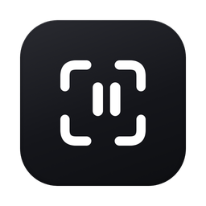
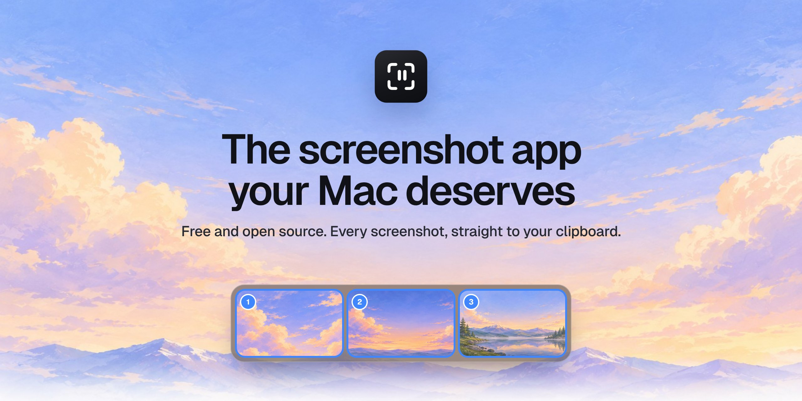

<div align="center">



# Peek

**The screenshot app your Mac deserves.**<br>
Every screenshot goes straight to your clipboard. Paste it anywhere, and never dig through your Desktop again.

[](https://github.com/nickwechols/peek/releases/latest)
[](#install)
[](Sources/Peek/Peek.swift)
[](LICENSE)
[](https://github.com/nickwechols/peek/releases)

### [Download for Mac](https://github.com/nickwechols/peek/releases/latest/download/Peek.dmg) &nbsp;·&nbsp; [Website](https://peekmac.xyz) &nbsp;·&nbsp; [Made by Nick Echols](https://github.com/nickwechols)

<br>



</div>

<br>

## Why Peek

macOS saves every screenshot as a file on your Desktop, and you go digging for it every time you want to paste one. Peek flips that around. The moment you capture, the shot is on your clipboard and in a small tray at the bottom of your screen. Paste it, mark it up, or grab a few at once. Your Desktop stays clean.

## Features

| | |
| :-- | :-- |
| **Copied the moment you capture** | Area or full screen. The shot is already on your clipboard, with a soft shutter sound you can turn off. |
| **Copy several, in order** | <kbd>⌘</kbd>-click previews in the tray to pick shots in the order you want, then paste them all at once into Slack, Figma, Linear, your AI of choice or the group chat. |
| **Mark it up** | Double-click a preview for arrows, boxes, a pen, a highlighter, text, numbered steps and blur. Everything is copied as you go. Press Return and you are done. |
| **Screen recording** | Record an area or a whole screen, with click rings, your mic and your Mac's sound. The clip lands on your clipboard ready to paste, with one-click GIF and still frames for AI chats. |
| **Presentation mode** | Record your screen or one window with yourself on camera. Pick a window from a list, mark a retake when you fumble a line and Peek cuts back to your last pause. In the editor your camera stays movable: drag it to a corner, resize it, make it a circle, or hide it and go full screen for any part of the video. |
| **A quick video editor** | Trim, split and cut parts out, crop without losing anything, mute, and add arrows, boxes, text and numbered steps over time. Return saves a copy and copies it. |
| **Make it yours** | Seven themes and six accent colors across the Library, both editors and the preview, which you can size, style and drag to any corner. |
| **Works with your shortcuts** | Screenshots taken with the built-in macOS shortcuts land on your clipboard too. |
| **Shortcuts you choose** | Click any capture shortcut in the Library and press the keys you want. |
| **A Library, not a messy Desktop** | Every capture, grouped by day. Click to copy, <kbd>⌘</kbd>-click or <kbd>⇧</kbd>-click to copy several. |
| **Private by design** | No network requests, no analytics, no account. Everything stays on your Mac. |

## Install

1. **[Download Peek.dmg](https://github.com/nickwechols/peek/releases/latest/download/Peek.dmg)** and open it.
2. Drag **Peek** into **Applications**.
3. Open Peek. The setup guide walks you through screen capture permission, which macOS requires before any app can take screenshots.

> [!NOTE]
> **First launch.** If macOS says it cannot verify Peek, open **System Settings → Privacy & Security**, scroll down and click **Open Anyway**. You only do this once. It appears because this build is not yet notarized by Apple.

Requires macOS 13 Ventura or later. Runs natively on Apple silicon and Intel.

## Shortcuts

| Action | Default |
| :-- | :-- |
| Capture an area | <kbd>⇧</kbd> <kbd>⌘</kbd> <kbd>2</kbd> |
| Capture the screen | <kbd>⇧</kbd> <kbd>⌘</kbd> <kbd>1</kbd> |
| Record the screen (again to stop) | <kbd>⇧</kbd> <kbd>⌘</kbd> <kbd>0</kbd> |
| Open the Library | <kbd>⇧</kbd> <kbd>⌘</kbd> <kbd>L</kbd> |
| Copy several, in order | <kbd>⌘</kbd> Click |
| Mark up | Double-click |
| Markup tools | <kbd>A</kbd> <kbd>R</kbd> <kbd>P</kbd> <kbd>H</kbd> <kbd>T</kbd> <kbd>N</kbd> <kbd>B</kbd> |
| Done, already copied | <kbd>Return</kbd> |
| Video: play, split, cut, crop, mute | <kbd>Space</kbd> <kbd>S</kbd> <kbd>Delete</kbd> <kbd>C</kbd> <kbd>M</kbd> |

Capture shortcuts can be changed in **Library → Shortcuts**.

## Privacy

Peek works entirely on your Mac. It makes no network requests and collects nothing. Screenshots are saved to `~/Pictures/Peek`, recordings to `~/Movies/Peek` (or a folder you choose), and to your clipboard, and nowhere else. The microphone and camera are only used while you record with them switched on, and your camera is saved on your Mac next to the recording.

## Build from source

Requires Xcode 15 or later.

```sh
git clone https://github.com/nickwechols/peek.git
cd peek
./scripts/build.sh            # builds build/Peek.app and build/Peek.dmg
./scripts/build.sh --install  # also installs it to /Applications and opens it
```

The project is a Swift package, so you can also open the folder in Xcode and press Run.

<details>
<summary><b>Signed and notarized releases</b></summary>

<br>

With an Apple Developer ID, the build script signs with the hardened runtime and notarizes, which removes the first-launch prompt:

```sh
xcrun notarytool store-credentials peek   # once
DEVELOPER_ID="Developer ID Application: Your Name (TEAMID)" NOTARY_PROFILE=peek ./scripts/build.sh
```

Pushing a version tag (for example `v1.0.0`) runs the [release workflow](.github/workflows/release.yml), which builds the installer and attaches it to a GitHub Release.

</details>

<details>
<summary><b>Project layout</b></summary>

<br>

```
Sources/Peek/Peek.swift   The app: capture, tray, editor, Library, settings, setup
Resources/                App icon, Geist font, setup artwork, installer background, shutter sound
scripts/                  Build script and artwork renderers
design/                   Sources for the installer background and the GitHub artwork
site/                     The landing page (peekmac.xyz), served by Caddy on Railway
```

</details>

## Contributing

Bug reports, ideas and pull requests are welcome. Read [CONTRIBUTING.md](CONTRIBUTING.md) to get started, and see [SECURITY.md](SECURITY.md) for reporting a vulnerability.

## Credits

Designed and built by **Nick Echols**.<br>
[GitHub](https://github.com/nickwechols) · [Instagram](https://instagram.com/fromnickechols) · [Website](https://peekmac.xyz)

- [Geist](https://vercel.com/font) by Vercel and basement.studio, bundled under the SIL Open Font License ([Resources/Fonts/OFL.txt](Resources/Fonts/OFL.txt)).
- The landing page uses [Phosphor Icons](https://phosphoricons.com) and [GSAP](https://gsap.com).
- Product names and logos in the landing page demos (such as Claude, Figma, Slack and Linear) belong to their owners and appear only to show where you can paste.

## License

Peek is free and open source under the [MIT License](LICENSE). Use it, change it, share it.
